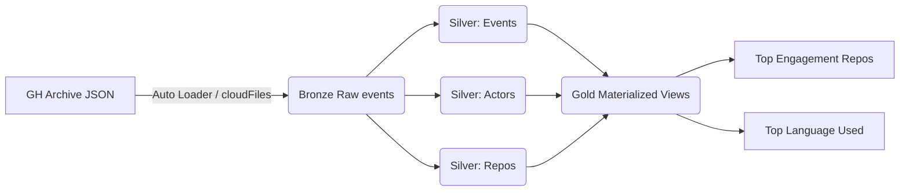

# GitHub Activity Pipeline


A data engineering pipeline built on Databricks Delta Live Tables (DLT) and Lakeflow that ingests, cleans, and distills **half a billion GitHub events** into a queryable star schema.

## Overview & Motivation

Public GitHub activity is published continuously as raw event logs — high-volume, messy, and full of bot noise. This project builds a production-style lakehouse pipeline against that real-world stream, rather than a cleaned tutorial dataset, to get hands-on with the problems that actually show up at scale: schema evolution, deduplication, streaming ingestion throughput, and enforcing data quality before bad records reach analytics.

The result is a star schema — deduplicated actor and repo dimensions joined to a cleaned events fact table — ready for direct analytical querying.

## Architecture

Medallion architecture, optimized for high-throughput streaming and automatic schema evolution:



- **Bronze** — Raw JSON ingestion using Auto Loader (`cloudFiles`)
- **Silver (Events)** — Flattened event logs, filtered for bots, and optimized with Liquid Clustering
- **Silver (Actors/Repos)** — Keeping developer and repository dimensions unique and current
- **Gold** — Materialized Views for Top Engagement Repositories and Top Language Used analytics

## Tech Stack & Rationale

| Component | Why |
|---|---|
| **Databricks DLT + Lakeflow** | Declarative pipeline definitions with built-in data quality expectations and managed orchestration |
| **Auto Loader (`cloudFiles`)** | Incrementally and efficiently ingests new files as they land, without reprocessing the full history each run |
| **Liquid Clustering** | Clustered by `event_id`, `type`, and `created_at` for sub-second query performance at this row count, without the maintenance overhead of static partitioning |
| **DLT Expectations** | Enforced at the Silver boundary so NULL IDs or malformed events never reach downstream tables |
| **AWS S3** | Durable, low-cost storage backing the lakehouse |

## Performance & Results

- **447,635,830 rows** processed end-to-end
- **19m 06s** total runtime — an ingestion rate of **~23.4 million rows/minute**
- Sub-second query performance on the Silver events table via Liquid Clustering

## Project Structure

```text
.
├── 1. bronze
│   └── Hourly Data Ingestion.py
├── 2. silver
│   ├── actors
│   │   └── Clean Actors Data.py
│   ├── events
│   │   └── Clean Events Data.py
│   └── repos
│       └── Clean Repos Data.py
└── 3. gold
    ├── Most Engagement Repos.py
    └── Most Used Programming Language.py
```

## Getting Started

1. **Add source** — mount the Bronze layer to your GitHub Archive S3 path.
2. **Configure S3** — ensure bucket permissions are set for both Unity Catalog and the relevant IAM roles. See [Databricks: add data from external locations](https://docs.databricks.com/aws/en/ingestion/cloud-object-storage/add-data-external-locations).
3. **Create pipeline** — create a new DLT pipeline under Databricks Jobs & Pipelines.
4. **Run** — select **Full Refresh** for the initial full ingestion.

## Sample Insight Query

```sql
-- Find the fastest growing languages
SELECT
    language,
    count(*) as total_events
FROM workspace.silver_events
WHERE type = 'PushEvent'
GROUP BY language
ORDER BY total_events DESC
LIMIT 10;
```

## Data Quality & Testing Strategy

1. **Schema evolution** — introduce sample actor/repo records with a divergent schema to confirm the pipeline adapts without breaking downstream tables.
2. **Query speed at scale** — load additional 10GB sample batches to benchmark query performance and identify where further optimization (clustering, partitioning, caching) pays off.

## Challenges & What I Learned

Deciding which SCD type the pipeline should follow. I ended up using both:
- Type 1 (overwrite) for data where only the latest state matters, such as routine updates.
- Type 2 (append new rows) for data where historical records are needed for analysis.

Deciding between a fixed schema and a schemaless approach for schema evolution. Going schemaless lowers storage and maintenance costs, but trades off query speed — which in turn drives up compute cost. To balance this, the pipeline enforces schema on top of S3-backed storage, keeping storage costs down while still getting the query performance needed.

## Future Improvements

- Move from hourly batch to near-real-time streaming ingestion
- Consider other tools such as dbt, Prefect, Airflow, etc if they have significant advantages. 
- Expand the Gold layer with additional analytics (e.g. contributor growth over time, language trend lines)

## Source & Learning Material

- Data source: [GH Archive](https://www.gharchive.org/)
- Reference: [Databricks: Get started with data pipelines](https://docs.databricks.com/aws/en/getting-started/data-pipeline-get-started)
